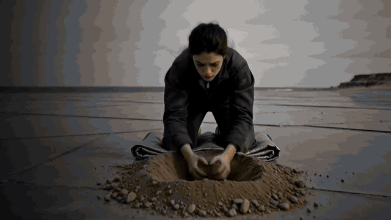

# haggs

An open-source film studio on Comfy. Make a picture, a clip, a series or a
whole film, swap a person into any video, and finish it in an editor with
separate tracks for voice, effects and music. Every button shows what it
costs, in credits, before you press it.

Built for Comfy's **#OpenSourceHiggsfield** challenge. MIT licensed.



**Watch it:** `docs/demo/` has the demo video script and the voice-over; the
rendered video is linked from the challenge entry.

## What you can do

**Start with one that works.** Twenty-six ready-made apps, one click each,
opening as a simple form: swap a person in a video, replace or cut out a
video's background, relight or upscale a photo, try an outfit on a person,
make a product ad, lip-sync a video to any voice, make a portrait speak.
Every one is a real Comfy workflow, checked against Comfy Cloud's node
catalog. The four that run on open weights alone say so.

**Build your own on an open canvas.** Drop steps and whole Comfy library
workflows anywhere, draw a line from what one makes to what the next needs,
and stack as many as you like. Swap any step for an open-weights or partner
workflow that does the same job. When it runs the way you want, turn it into
an app, run it, save it with its result as the cover, share it as a file or on
the Community shelf (free, or a creator fee of up to 12¢ a run, 80% to the
creator).

**Photos.** Make, edit, build **characters** that stay the same person across
shots (traits or photos of someone who has said you may), and **locations** you
can walk the camera around. Any finished picture can be animated or edited in
one click, handed to the next page as the first frame.

**Draw to video.** Pick a picture and sketch arrows on it: one kind for what moves, one for where the camera
goes. haggs writes the motion in plain words, you can edit it, and it hands the picture and the motion to Video,
where the price is on the Generate button as always. Nothing is spent on the drawing page.

**Video and Series.** A clip from words or a picture. A **Series** turns a topic
into a run of short vertical videos: pick a format (What if, POV, Story,
Faceless channel, Did you know, Top 5, Influencer), who is in it and how it
looks, then make the pictures and animate them on the same page. Faceless
channels get a narrator, spoken with ElevenLabs.

**Recreate an edit.** Drop a reference video (a trailer, an ad, a viral cut). A
video model (Gemini on Comfy) lists every shot: its length, what the camera
sees, the camera move, the words on screen. haggs rebuilds the same edit around
your character and place as a board, shot for shot, ready to make and cut.

**The editor.** Every take a shot has had is kept. Play it, trim it (I and O),
split it (S), undo anything (⌘Z). Then:

- **Tracks.** Video sound, Voice, Effects and Music each have their own lane,
  mute and level. Effects are made from words (ElevenLabs Sound Effects) or
  added as files, and dragged into place on the timeline.
- **Blend the voices.** Level, warmth and presence for the lines; the music
  never ducks unless you ask it to; master to −16 LUFS.
- **Reshoot** a shot from a new angle with a dial: FLUX 3, or the open-weights
  Qwen multi-angle workflow.
- **Fix a frame.** Grab one frame, fix it with FLUX Kontext, re-render the take
  from the fix.
- **Restyle.** Redraw a take in cel anime, claymation, scribble, pixel art and
  more from a style sheet, or make a whole **style reel**: one take in several
  looks, each named on screen.
- **Swap, recast, voice and lip-sync, bridge and extend.**
- **Finish.** Review markers (M), fades in and out on a clip, fit or fill with a
  focal point, titles laid over the picture on their own lane, named versions
  you can restore (the current cut is kept first), and cutdowns: a window of
  the cut as its own board.
- **Render MP4** with captions and titles burned in, or export an ffmpeg script
  or a Final Cut / Resolve file (FCPXML 1.10, 30 fps, connected lanes).

**Academy.** Seven short lessons, about 90 minutes, from your first video to a
finished film. Each ends in something real in haggs; finish all seven for a
certificate.

**Claude, over MCP.** `scripts/mcp.ts` is an MCP server. Claude can read your
projects and send you work to apply: drafts, boards, edits, takes, voices, a
series, or an app laid out on the canvas (`haggs_propose_canvas`,
`haggs_propose_series`), and search Comfy's workflow library
(`haggs_find_workflows`). Nothing changes until you press Apply, and no
separate API key is needed.

**Ads.** Type a company's website and haggs reads the brand (name, logo, colours,
fonts, a line about it). Add the products, choose formats (product shot, poster,
marketplace listing, social post, story ad) and audiences, and make a batch of up
to 20 ads that look like they belong to that company. The **Ad Multiplier**
remakes an ad that already works for new audiences and in other languages, keeping
the product and layout. Three one-tap samples fill the page in; a picture costs
about 7¢.

**Sizzle doctor.** Add a finished film and haggs reads the cut itself, on the
server with ffmpeg and no model: length, how fast it opens, hard cuts against
dissolves, whether it builds, movement, loudness and dead air at the start. It
scores the cut and says what to change. Free, and nothing is generated.

**Finish for the feed.** Export presets for X, vertical (TikTok, Reels, Shorts)
and YouTube, with a vertical re-frame that follows the faces and a pass that
masters to -14 LUFS. A pack of one-click looks (VHS, CRT, glitch, thermal, night
vision) made from ffmpeg filters. Music from words, made in the editor.

**More models, one route.** Kling 3, Seedance 2 and 2.5, Veo 3.1, Nano Banana 2
and FLUX Kontext run as Comfy Cloud workflows, so they work on every account and
Comfy prices them before they run.

## Open weights and your own GPU

Open weights means the model's weights are published, so anyone can run it
anywhere, with no partner API in the loop. haggs marks which workflows are
open (a node flagged `api_node` in Comfy's catalog calls a partner's paid API).
Under **Keys → Your own GPU**, point haggs at a ComfyUI on your computer or
network (for example an RTX 5090 on `127.0.0.1:8188`). Open-weights workflows
then run there, free, instead of on Comfy Cloud. Only loopback and private
network addresses are accepted, and no key is ever sent.

## What runs where

Everything that makes a picture, a clip or a sound runs on **Comfy**: Comfy
Cloud workflows built from Comfy's own nodes (MiniMax H3, FLUX 3, FLUX Kontext,
Kling Omni, Runway Aleph, Higgsfield Genjutsu, ElevenLabs, Sync, and the open
Qwen, Wan, LTX and Z-Image workflows), or your own ComfyUI. You use your own
keys; each run's price comes from Comfy's published node prices. Estimates, not
invoices. Editing, mixing and rendering run locally with ffmpeg.

Projects live in your browser (IndexedDB). Export and import them as files.

## Run it

```bash
npm install
cp .env.example .env.local   # then add your keys
npm run dev          # http://localhost:3111
npm test             # the suite
npm run typecheck
```

You need Node 22 and ffmpeg (for Render MP4 and frame grabs). Add keys from the
key chip in the header, or in `.env.local` for development:

| Variable | For |
| --- | --- |
| `COMFY_API_KEY` | generation on Comfy Cloud |
| `COMFY_LOCAL_URL` | your own ComfyUI, e.g. `http://127.0.0.1:8188` (optional) |
| `ANTHROPIC_API_KEY` | Haggy and the writer, if you'd rather not use MCP (optional) |
| `FAL_KEY` | fal models (optional) |
| `HAGGS_LOCAL_MEDIA` | a folder for renders, uploads and local footage (development) |
| `NEXT_PUBLIC_SUPABASE_URL`, `NEXT_PUBLIC_SUPABASE_PUBLISHABLE_KEY` | sign-in and Community (optional) |
| `STRIPE_API_KEY`, `STRIPE_PRICE_*` | subscriptions (optional; checkout stays off without them) |
| `BLOB_READ_WRITE_TOKEN`, `NEXT_PUBLIC_HOSTED` | hosted file store (Vercel Blob) |

The switches for a live deployment (sign-in, file store, plans, credits) are in `docs/launch.md`.

Community needs the migration in `supabase/migrations/` applied to your
Supabase project (paste it into the SQL editor).

To use Claude with your projects, copy `.mcp.example.json` to `.mcp.json` (that file is local and not committed); it registers the haggs MCP
server for Claude Code; for any other client run `npx tsx scripts/mcp.ts`.

### Development only

Keeping renders on disk, serving local footage (`/api/local`), uploads, Render
MP4 and the Claude bridge run only under `npm run dev`, on this machine. A hosted
deployment needs a file store in their place.

## Layout

```
src/
  app/        pages: landing, projects, the project tabs, Photos, Video, Series, Workflows, Academy
  academy/    the seven lessons and your progress
  catalog/    models, settings, prices
  characters/ traits, sheets, identity locks
  comfy/      workflow converter, apps, canvas, ready-made apps, library
  community/  fees, publishing, charging a run
  providers/  Comfy Cloud and local ComfyUI runners, workflows, prices
  series/     formats, drafting, building a series
  sheets/     screenplay parsing, the sheets, formats, camera moves
  story/      projects, boards, takes, the cut and its mix
  styles/     looks, style sheets, style reels
  server/     local media, the Claude bridge, rendering, billing
  writer/     Claude drafting and filling
scripts/      the MCP server, project import
supabase/     the Community migration
docs/demo/    the demo script and voice-over
```

## Licence

MIT. See `LICENSE`.

## Contributing

Fixes, workflows, Series formats and looks are welcome. Read [CONTRIBUTING.md](CONTRIBUTING.md) first; report a security
problem privately as described in [SECURITY.md](SECURITY.md). Everyone is expected to follow the
[code of conduct](CODE_OF_CONDUCT.md). MIT licensed.
