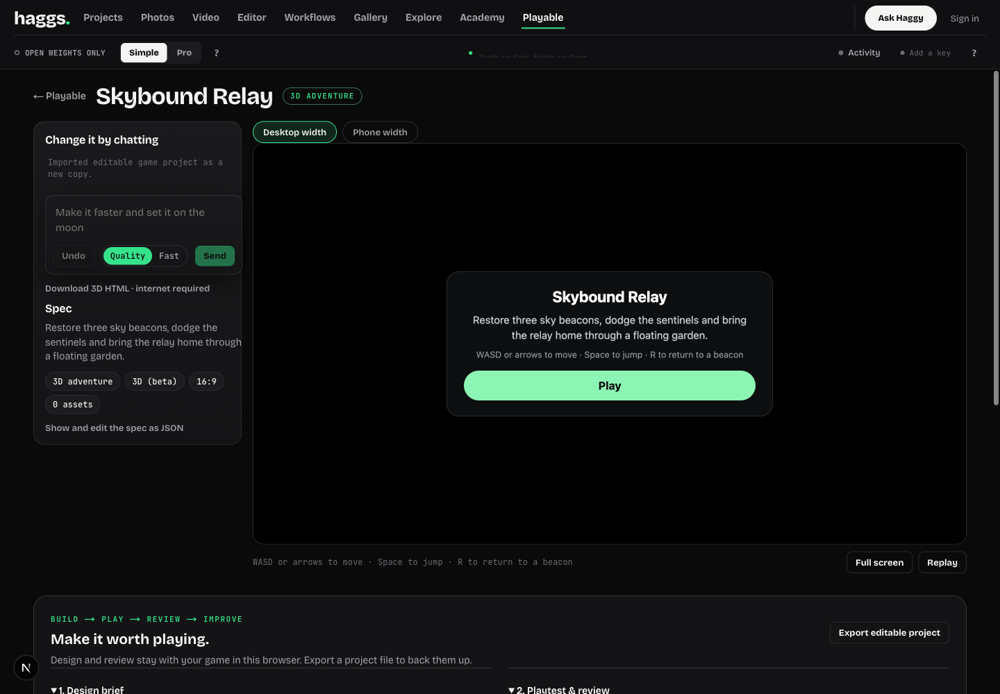
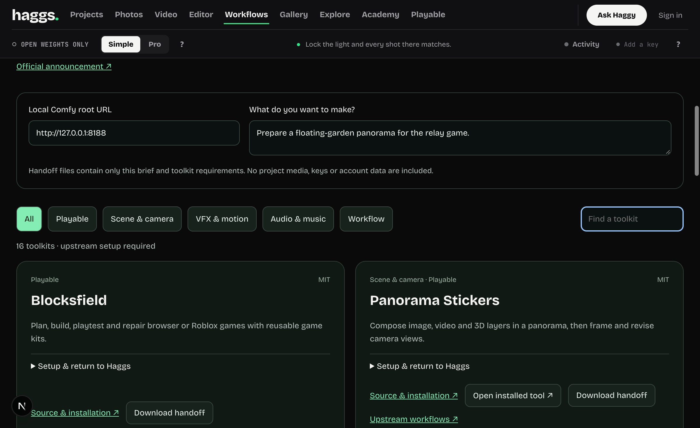

# Community toolkit integration and Playable upgrade — 10 November 2026

Source: https://comfy.org/open-source-higgsfield#challenge-content. Reviewed the official links, each repository's README and GitHub code-licence metadata. This is a fit assessment, not a claim that GPU output or every upstream feature was reproduced.

## Implemented in this branch

- `/playable`: an original procedural Three.js adventure, Skybound Relay. Three beacons, connected floating islands, moving hazards, four lives, jump, recovery, ending, touch pad, procedural sound. No paid generation or upstream game code copied.
- Each game has a design brief, manual quality checklist and notes, named checkpoints, and editable project JSON import/export. Restoring a checkpoint uses the existing Undo history. Older saved games still load.
- Code-game runtime observations track ready/start/score/end/error events from the expected sandbox frame, tied to the current spec revision. Replay resets observations. Game-reported events are diagnostic, not automatic quality scores or a proof of reachability.
- Improvement requests use the saved brief and current human review. They fill the existing chat; the user chooses whether to send a potentially billable Claude request. There is no autonomous paid repair loop.
- Desktop/390px preview widths. This is not a physical-device certification.
- Explicit 3D HTML export uses the existing pinned Three.js network runtime; its label says internet is required. Offline standalone export still rejects 3D unless external-runtime use was explicitly selected. The scripts-only sandbox and media bundling remain in use.
- `/workflows/toolkits`: a credited shelf of all 16 distinct recognised repositories, filtered by production stage. Setup links, explicit requirements and JSON handoff packets. Verified Comfy app paths can be opened on an explicitly chosen loopback/private host. Packets contain only the typed task brief and static toolkit requirements, not keys or project media.

## Where each project fits

| Project and repository | Code licence reported | Haggs destination | Integration boundary |
| --- | --- | --- | --- |
| [Blocksfield](https://github.com/Hcoder10/blocksfield) | MIT | Playable | Build/play/review/repair process informs original workbench; ThreeKit/Roblox/GPU builder remains a separate runtime |
| [Panorama Stickers](https://github.com/nomadoor/ComfyUI-Panorama-Stickers) | MIT | Locations, cameras, game backgrounds | Open installed Comfy, load upstream workflow; import rendered panorama or shot manually |
| [Imagination Studio](https://github.com/drowzeys/Imagination-Studio-by-keys-Wasserman) | Apache-2.0 | Film planning, machine qualification | Separate supported installation; no bundled model runtime |
| [Paint a Plate](https://github.com/AInVFX/ainvfx-paintaplate) | Apache-2.0 | Shot repair/VFX | Open installed plate app; return edited media as a take |
| [ComfyArt](https://github.com/jtydhr88/ComfyArt) | MIT | Concept boards and game art | Open installed canvas; import exported art |
| [Creativefield](https://github.com/rhymeas/Creativefield) | GPL-3.0 | Keyframes, blockouts and region edits | External application, no GPL UI code bundled |
| [Genobi](https://github.com/koshimazaki/genobi) | MIT | Agent direction, scene/audio planning | Brief handoff and separate media output |
| [H3 Motion](https://github.com/PxTicks/h3-motion) | AGPL-3.0 | Subject paths, sprite motion | External local node/runtime setup; no AGPL UI code bundled |
| [Reshoot 4D](https://github.com/itsmetamike/reshoot-4d) | AGPL-3.0 | Moving-performance camera retakes | External capture/reconstruction/generation pipeline |
| [OneShot MV](https://github.com/VisualFrisson/ComfyUI-OneShotMV) | MIT | Music-video planning and assembly | Open installed app; import shot outputs/video/EDL |
| [Freefield](https://github.com/neuregex/freefield) | MIT | Workflow manifests and capability disclosure | External app recipes, not an incompatible manifest import |
| [Splat Edit Engine](https://github.com/Burgstall-labs/ComfyUI-SpEdE) | AGPL-3.0 | Future Worlds/splat assets | No native splat importer in this branch; rendered media supported |
| [Sonder Editor](https://github.com/SonderSaid/ComfyUI-Sonder-Editor) | GPL-3.0 | Range edits and take iteration | Separate editor; no GPL source port |
| [Max Editor](https://github.com/xentome/EDITS-WITH-AI) | Apache-2.0 | Music-timed H3 shots | Separate model/runtime installation |
| [Henge](https://github.com/alisson-anjos/Henge) | MIT | Swap and guide-motion tools | Separate node/model/LoRA setup |
| [H3 Audio Retake Studio](https://github.com/Nebuluss/H3-AudioRetake-studio) | MIT | Short dialogue/lip repairs | Open installed app, audition, return selected take |

## Next native integrations

1. Connect a configured local Comfy runtime and query actual node/model availability before enabling any toolkit job. Keep cloud and own-GPU routing explicit.
2. Add job-specific adapters and result import for Panorama, Paint a Plate and audio retakes, retaining sources and selected intervals. Validate with installed nodes and synthetic assets before using personal media.
3. Add concept-art comparison and a real automated playtest/repair harness to Playable, with bounded optional model calls. Manual checks in this branch must not be presented as automated judging.
4. Reconcile native 3D asset work with draft PR #140. Do not merge that branch or represent its procedural scene as finished photoreal assets.

No models were installed, no cloud GPU was provisioned, no paid inference was run, and no production settings or database were changed. Upstream applications, dependencies and model weights retain their own licences. No upstream implementation source or demo assets were copied into Haggs by this branch.

## Verification in this checkout

- `npm run typecheck`: passed.
- `npm test`: 1,501 passed, eight skipped, zero failed (1,509 total).
- `npm run build`: passed.
- Real Chrome: starter played with keyboard to all three beacons and win, no game-reported errors; brief/review/checkpoint saved; restored checkpoint, undid restore, reloaded; exported and imported a new project copy retaining its brief and review; 3D HTML downloaded; improvement request prepared without sending.
- Browser tests found and fixed loss of saved review text when preparing an improvement request after saving/reloading, plus inconsistent final-score display.
- Toolkit browser checks: all 16 entries, stage filter, text search, handoff download and non-local launch rejection. Home, studio and toolkit pages fit a 390px viewport. This is a simulated viewport, not a physical phone test.
- No real upstream Comfy toolkit runtime, automatic repair/vision judge or paid model request was exercised.

