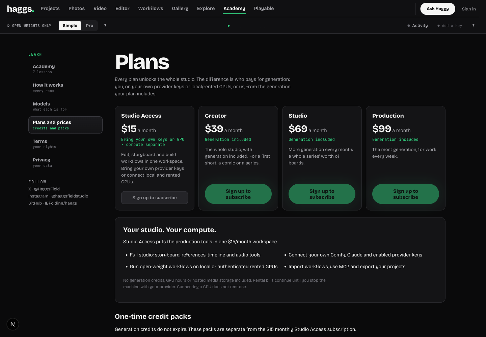
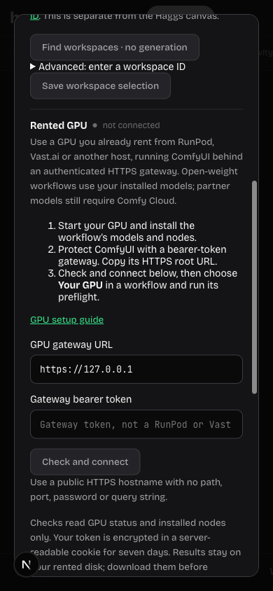

# Studio Access and rented ComfyUI GPUs

The $15/month BYOK plan is now presented as **Studio Access**. Its internal `byok` ID, price environment variable, monthly amount, zero included credits and zero hosted storage allowance stay unchanged. The offer emphasizes the production workspace: storyboards, references, timeline/audio tools, workflow apps, MCP and exports. Provider compute and rental disks remain separately billed.

## Connection flow

1. User starts a GPU and installs ComfyUI/models/nodes with their provider.
2. They protect ComfyUI behind a bearer-authenticated public HTTPS gateway. `tools/gpu/gateway.py` is a minimal standard-library gateway; it only forwards Haggs' Comfy API routes to private localhost:8188. It never forwards the bearer token to ComfyUI.
3. Connection settings → Rented GPU accepts endpoint and gateway token (not provider admin credentials).
4. Check and connect first verifies anonymous requests are denied, then reads authenticated system stats and node catalog. No prompt, upload, rental or billing request occurs.
5. Production requires a signed-in user and `HAGGS_GPU_CONNECTION_SECRET` (64 hex characters). Credentials are encrypted in an account-bound HttpOnly, Secure production cookie for seven days. Selecting local/rented GPU replaces the other active GPU connection only after successful checks.
6. Workflows explicitly select Your GPU or Comfy Cloud. Preflight checks installed nodes, models and GPU before submission; the existing partner-node guard remains. Upload, prompt, polling and downloads all use the same authenticated transport. Submissions are never automatically retried.
7. Rented outputs stay on the user's GPU disk. Account/endpoint/token-bound preview links relay only output media through the sealed connection, with private/no-store headers. No hosted storage is implied. Download before terminating/deleting the rental disk. A link is not a backup.

## Transport boundary

Local/private-network validation remains unchanged. Rented connections require a clean public HTTPS DNS origin. Each request resolves all IPv4 answers, rejects non-public destinations, and pins an approved address into a fresh TLS connection (with normal hostname/certificate validation). Redirects, alternate origins, admin routes, caller cookies and caller provider keys are refused/not forwarded. Request/result bounds are 50/100 MB. Token values are never returned by server actions or logged by the included gateway.

Only bearer-protected standard ComfyUI APIs are supported. Provider dashboards, serverless APIs, HTTP-only endpoints and managed APIs using different schemas are not interchangeable. RunPod's raw default ComfyUI proxy is unauthenticated: expose the protected gateway instead. Vast.ai/custom hosts require a compatible HTTPS reverse proxy. This implementation does not automatically provision or stop rentals.

## Verification and release boundary

- Node tests cover address/IP/route rejection; account-bound encryption, tampering and expiry; read-only connection checks; DNS pinning and credential isolation with a mocked HTTPS socket; no redirects/retries; GPU upload/queue/history/result fixtures; rented output references without hosted storage.
- Python gateway test runs an actual local gateway + mock Comfy HTTP server: anonymous/wrong-token rejection, successful authenticated status check, no credential forwarding and admin-route rejection.
- Browser checks at 1440px/390px: plan content, connection form validation, cleared token, no cookie saved on invalid input, no document overflow, setup guide, unauthenticated output rejection.
- Final verification: `npm run typecheck` passed; `NEXT_DIST_DIR=.next-build npm run build` passed; `npm test`: 1,511 tests, 1,503 passed, 8 skipped, 0 failed. `python3 tools/gpu/test_gateway.py` passed. Browser also verified Run stays disabled until an explicit destination is selected, and Your GPU without a connection fails without cloud fallback.
- No real rented endpoint was provided. No GPU was rented, model installed or paid generation submitted. Production encryption-key configuration, an authenticated real endpoint/model preflight, approved real render, hosting media-size/egress behavior and reconnect/download rehearsal remain required before release. No live Stripe or production deployment changes were made.

## Primary references

- [RunPod official ComfyUI pod guide](https://github.com/runpod/runpod-plugins-official/blob/main/plugins/runpod/skills/runpod/golden-paths/02-comfyui-pod/README.md): HTTPS proxy format and unauthenticated proxy boundary.
- [Vast.ai ComfyUI image](https://github.com/vast-ai/base-image/blob/main/derivatives/pytorch/derivatives/comfyui/README.md): provider setup reference. Compatibility depends on the configured gateway, not the provider name alone.
