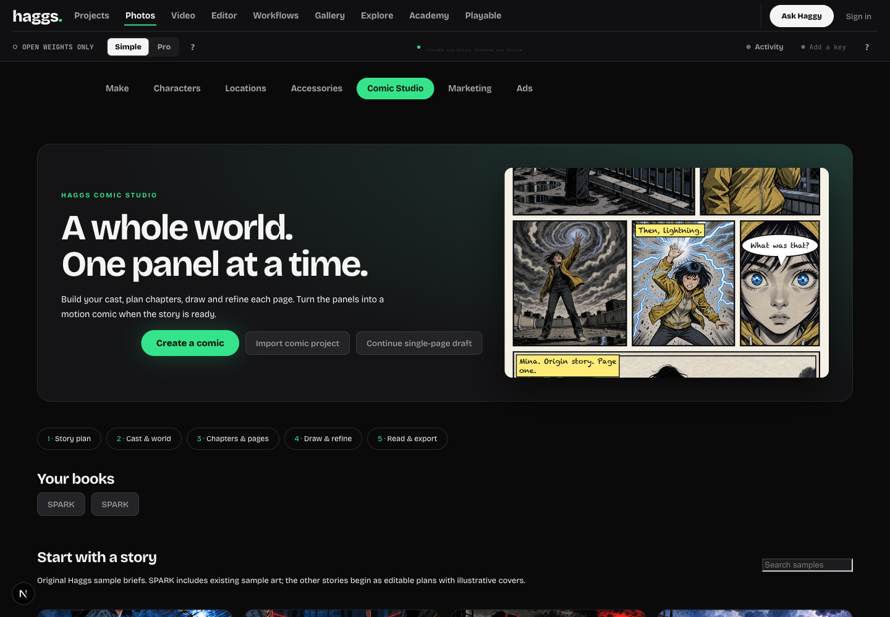
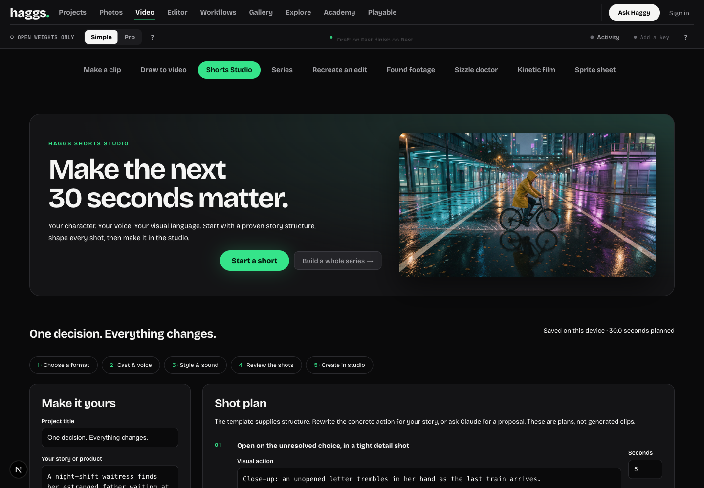
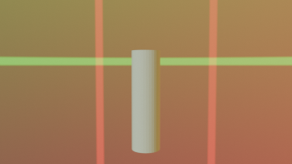

# Creator studios and Imagination Studio reuse

## What was actually reused

Reviewed Imagination Studio's root notices, Slate project/prompt compiler and portable package writer, hardware qualification helpers and memory manager at commit `ef88a0747686212749768b72d6a796932e8e583d`.

Two **unmodified Apache-2.0 editorial data files** were copied: 12 coverage plans and 165 camera/style/lighting setups. Byte hashes and provenance are in `third_party/imagination-studio/provenance.json`. Original LICENSE, root NOTICE and Slate NOTICE are retained. Keys and Sam Wasserman / Wasserman Productions are credited in the director's library and `/credits`, linked from the footer.

No upstream runtime code, artwork, demo videos, model weights or installers were copied. The TensorFold/MLX/native Windows engines do not fit directly into this Next.js/Comfy runner. Their machine passes cannot be inherited; model licences remain separate. The portable-pack compiler, shot continuity compilation and ownership-aware memory scheduling are useful future adaptations, not implemented ports in this change.

## Working additions

### Comic Studio

`/comics` has books, chapters, pages, original sample briefs, cast/world notes and per-page drafting. SPARK uses two existing Haggs illustrations; the other three samples begin as script plans with illustrative existing Haggs covers. Optional Claude planning creates a separate book rather than replacing the original. Literal script splitting is free, keeps all sentences, and refuses oversized sections rather than silently discarding story.

Pages open in the existing `/comic` editor with a distinct storage key. The old single-page draft is preserved. Panel art versions survive redraw/upload/retouch; retouch requires an explicit price check and user click. Dialogue and lettering remain editable. The book reader, chapter CBZ with PNG pages, project JSON and browser print/Save as PDF are implemented. JSON is editable project data with media references, not a promise of offline asset packaging. Local drafts are not account-backed publishing. The existing Explore remains the community route; no fake likes, accounts or views were added.

### Shorts Studio

`/shorts` contains 12 original format briefs across Story, Creator, Product, Music and Education. Users select a character, voice/style, edit/reorder timed shot descriptions and narration, optionally import a soundtrack, and create a real 9:16 storyboard with those choices. Optional Claude planning is explicit and bounded to 6–12 shots. Changing a brief refreshes untouched template context without erasing authored shots. Switching templates preserves five prior drafts.

Audio onset suggestions are local signal analysis, not a claim of AI musical understanding or trailer quality. Existing Haggs clips are labelled illustrative previews, not twelve independently generated finished samples. Storyboard creation submits no generation. Rendering and speech use the existing studio controls with their own provider costs and limits.

### Grey Room and production tools

- Validated 2:1 panorama import, yaw/exposure controls, saved-set persistence and actual WebGL sky preview. Blender environment textures and floor/wall visibility are included in its manifest/script; inline image assets are included in local Blender ZIP export. Sky pixels are **not** included in plain geometry guides or the existing 2D draft compositor.
- Drawn position paths write real layer animation keys. Rotation, opacity and other existing keyed channels survive. This moves a cutout/prop; it does not synthesize a new performance.
- Slate coverage and directing setups create a separate editable storyboard. Cameras are suggested blockouts, not automatic guarantees of matched eyelines or final shot quality.
- `/production-tools` opens configured upstream workflow JSON in the existing real input form/preflight/runner for supported media outputs. Pack-specific editors and reconstruction stages remain upstream installations. This is a generic executable workflow adapter, not a claimed complete native port of Paint a Plate, Reshoot 4D or SpEdE.
- `/machine` reads GPU status, loader choices, node count/version and a setup summary fingerprint. It explicitly does not inherit hardware qualification or prove model execution.
- `scripts/playable-smoke-review.js` applies a bounded keyboard sequence to an existing local game, captures the expected iframe's runtime events and screenshots, and downloads a report. Tested against a locally saved Skybound Relay project from PR #141: game-reported win, no game-reported runtime errors. No AI judging or repair calls are made. #141 remains a separate draft.

## Verification

- TypeScript check passed.
- Full Node suite: **1,524 total, 1,516 passed, eight skipped, zero failed**.
- Production build passed.
- Real Chrome at 1440px and 390px: sample book creation, panel edit → save → reload, separate blank page, Shorts → real storyboard, coverage → six-shot storyboard, Grey panorama upload/yaw → save → reload, actual position-key application and no document overflow in the new studios.
- Real CBZ download: PNG signature, ZIP extraction and CRC verified with Python's independent zipfile reader. Browser print preview opened with rendered art. A PDF was not saved through the OS print dialog.
- Real local Blender export API returned a ZIP with exact inline panorama bytes, manifest and builder. `npm run check:grey-panorama` builds the complete scene and renders a real 320×180 PNG with fatal Python errors enabled. The first informal fixture omitted a required actor and produced a partial render after an exception; it was rejected and replaced by this stricter successful check. This proves a synthetic scene pipeline, not production film quality.
- Source data hashes match the pinned upstream files. No provider inference, GPU rental or paid render was submitted.

## Hosted boundary

Live check on November 11: `https://haggs.vercel.app` returned 200, production deployment `dpl_FASRe6GkpbP6wvCCkWAaY3EGZXio`, main commit `b76275063a9818ed0bfa5cadd31bec97aff787e9`. Existing `/comic` and `/series` returned 200; new `/comics`, `/shorts` and `/machine` returned 404 before this candidate was deployed. Public billing status reported configured plans; this tool session was signed out, so no owner provider generation was verified.

Local ComfyUI at localhost:8188 did not answer. The new optional Claude planners and panel-retouch provider paths were not submitted. Dedicated upstream GPU workflows, authenticated provider execution, account-backed comic publishing, automated quality judging and production rollout remain separate readiness checks. Do not call them completed based on a successful build, a sample cover or a generic workflow import.

