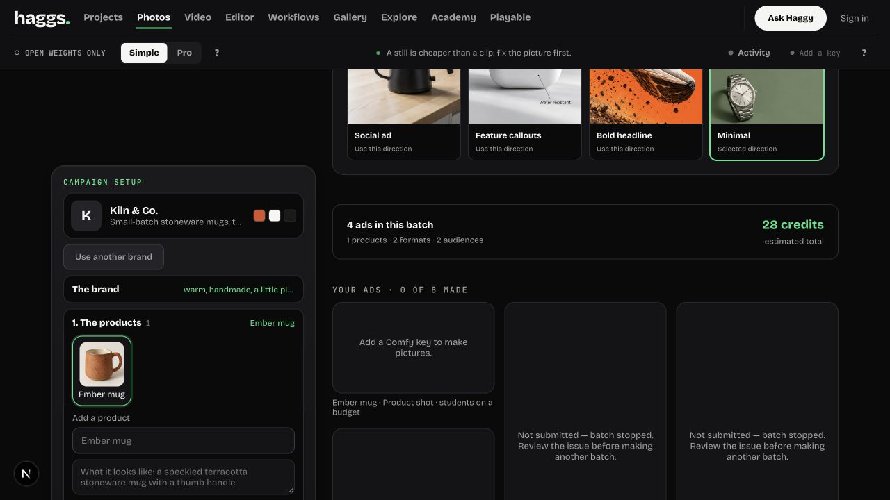

# Lazy credit billing initialization fix

Branch: `ads-studio-upgrade`, after evidence commit `3d2b889`. Apply the fix commit to combined release; no merge, push, deployment, credential changes or credit spend performed here.

## Behavior

An unconfigured Ads preview previously constructed Supabase before checking for any available Comfy key, returning `supabaseUrl is required.`. `liveDeps()` now creates request-scoped lazy credit operations. The Supabase client is constructed only for debit, refund or balance RPCs, using the same publishable key and requesting user's bearer token as before. No service-role credential or global client cache is introduced.

Missing URL or publishable key fails explicitly when credit billing is needed. No fallback authorizes a platform run. `decide()` still requires sign-in, storage preflight and an explicit `credits_spend` result of boolean `true` before returning platform access. A failed credit operation still releases the storage hold. Own-key gate checks, authentication, platform toggle, credit amounts and settlement logic are unchanged. Balance RPC errors now explicitly return false, even if an erroneous response also contains data.

## Regression evidence

- Five new tests cover missing-key behavior without client construction; sign-in and own-key gates; either missing billing setting with storage release and zero submissions; debit false/unexpected data/RPC errors vs successful debit ordering; and request-scoped client reuse with failed balance checks.
- 40/40 tests passed across platform, new credit operations, billing, storage quota, subscription storage and Ads handoff specs. All provider callbacks and billing RPCs in these tests are local fakes; no actual debit or generation is performed.
- Real browser smoke on isolated `127.0.0.1:3138/ads`, no keys and no signed-in account: Make returned `Add a Comfy key to make pictures.`, opened provider setup, and marked the remaining three ads Not submitted. No provider submission or credit operation was reached. The earlier failed batch remains in local history, so its historical Supabase error is still visible below the new result.
- `git diff --check` passed. TypeScript result recorded below.
- Combined-release checkout was not modified. Re-run its checks after applying this fix; hosted configuration and successful paid output remain unverified.

TypeScript passed (`node node_modules/typescript/bin/tsc --noEmit`, exit 0). The first attempt encountered stale generated types from the already removed local QA route; only that generated file was cleared before the successful rerun. Full production build was not rerun for this server-only fix; integration should run its release build after applying it.
