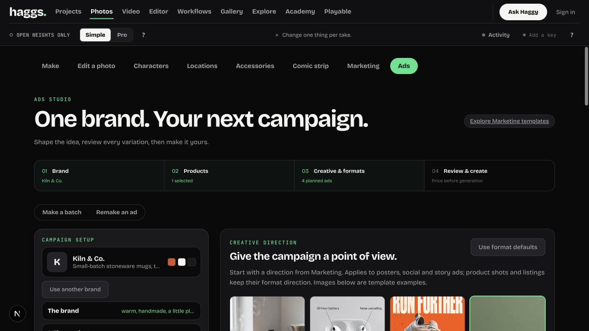
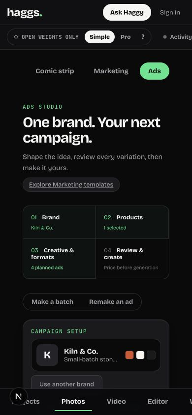

# Ads Studio upgrade — held for coordinated release

Branch: `ads-studio-upgrade`. Base: `935b5be7cd36e9a067e2af17041d279d399f3758`.
Checkout: `task-8/haggs-ads`. No merge, push, deployment, credentials, or paid generation.
Integration target: combined release task `01a18968-5cb9-762b-834b-9aeff501202b`. Apply only this branch's commit/diff; the integration checkout has unrelated staged work and was not modified.

## Comparison and scope

Reviewed https://higgsfield.ai/ads-studio and its public brand-research entry in the browser on 2026-10-30. The reference clearly separates static ads, multiplier, and brand setup. Its public page advertises product import and market insights; these were not verified behind authentication and are not claimed for Haggs. No Higgsfield assets were copied.

Reviewed Haggs Ads source and rendered updated flow, plus the current Marketing page. Reused Haggs design tokens, existing template images/directions, shared brand/product stores, the existing multiplier, and Studio handoff contract. This is a scoped implementation in the existing application, not a cloned site or a full accessibility audit.

## Changes

- Persistent campaign overview and four-step status, with a responsive two-column mobile status grid.
- Creative directions from Marketing: Social ad, Feature callouts, Bold headline, Minimal. Existing examples are identified as template examples, never as the user's results.
- Draft-persisted headline, CTA and notes. Text formats receive supplied copy/offers and a no-invented-claims instruction. Product/listing formats remain text-free and retain their original directions.
- Prompt review for each planned output, total estimated credits, exact 20-job exclusion warning, missing-photo explanation.
- New batches retain earlier outputs. Batch and multiplier submissions stop on the first failure; remaining jobs are explicitly unsubmitted. Exceptions release the busy state; interrupted drafts do not indefinitely say Making.
- Existing product references are resized/encoded using Marketing's shrink helpers before the same `makeStill` server action.
- Successful results can continue to Video or Edit with their image. Video gets animation instructions; Edit gets the original campaign prompt. These actions only prepare drafts; destination generation/pricing remains in that studio.
- Scoped CSS module avoids edits to the shared global stylesheet and other release work. Corrected sticky builder offset, single-column mobile form, wrapping result actions and keyboard focus styles.

## Verification

1. Brand/setup — healthy: existing sample brand loads shared product and four planned outputs; no generation. Manual and website setup retained.
2. Creative brief — healthy: Minimal, headline, CTA and notes selected, reloaded and restored from IndexedDB. Browser review showed the exact campaign text in a planned poster prompt.
3. Batch review — healthy: 11 audiences × 2 formats shows 22 intended / 20 submitted / 2 excluded and a 140-credit estimate; restored to four planned ads afterward.
4. Mobile — healthy at 390 × 844: document width equals viewport width (390), single-column form, two-column status/template grids. Desktop checked at 1280 × 720. Screenshots below.
5. Generation boundary — blocked by local billing configuration: real Make action reached `makeStill`, returned `supabaseUrl is required.`, and marked remaining three items Not submitted. No provider job or paid output was produced. Confirmed no local Comfy/platform key in the test process, and browser showed Add a key / Sign in. This is a server-action failure-path test, not a successful paid generation test.
6. Multiplier — healthy entry: tab opens, source required, submit disabled without an ad; existing product remains available. Source upload and paid remake not performed.
7. Video/Edit — contract tests cover resized reference, target, prompt, storage failure and route; compared against the actual Studio consumer. Successful result-button browser handoff remains untested because no generated result was produced in this isolated checkout.

Automated: **41/41 tests passed** with `node --import tsx --test src/brand/*.spec.ts`; `node node_modules/typescript/bin/tsc --noEmit` and `git diff --check` passed. **Production build passed** with `NEXT_DIST_DIR=.next-ads-build node node_modules/next/dist/bin/next build --webpack` (exit 0), including TypeScript and route generation. The first sandboxed attempt could not fetch existing Google Fonts; the network-enabled retry passed. Build-generated changes to tsconfig/next-env were reverted; build output and generated AGENTS.md are local untracked artifacts, not part of the release commit.

## Release gaps

- Authorized release environment must verify one bounded successful generation, downloaded output, and result → Video/Edit browser handoffs. No approval requested or assumed for paid calls here.
- No product scraping/import, market-insight service, performance claims, automatic posting, or new provider capability was added.
- Existing multiplier result history is replaced when rerunning (unchanged behavior); new batch results are preserved. New source clears the prior multiplier view to avoid showing old results as versions of a different source.

